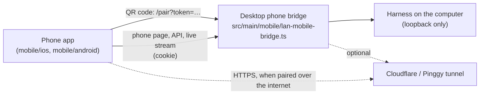

# Phone apps (iOS and Android)

> Status: first version built and tested in CI (simulator, emulator). Not yet in the App Store or Google Play; see [Releasing](#releasing).

unoblox works on a phone is a **companion to the desktop app**. The agent, the Harness runtime, your projects and your API key stay on the computer. The phone app pairs with that computer and drives it: you chat, answer the agent's questions, change the model or preset, and follow the work while it runs.

A phone cannot be the computer. iOS does not let an app run a shell, other processes or code it downloads (App Store Review Guideline 2.5.2), and Android only allows a limited version of that. So the phone app does not port the agent; it opens the desktop's own phone page, the same page phones already get by scanning Connect Phone in a browser.

## How it fits together

- **The page comes from the computer.** The app's web view loads the page that `lan-mobile-pages.ts` serves, so the page and the bridge API always match the desktop version. There is no second phone front end to keep in step, and no API version for an app store review to hold back. This follows the rule that maintained code has one authoritative input (`AGENTS.md`).
- **Pairing is the existing flow.** The app reads the Connect Phone QR code and opens its `/pair?token=…` link. On Wi-Fi the bridge sets its session cookie right away; over an internet tunnel it asks for the PIN first (`docs/mobile-pairing-pin-design.zh.md`). The cookie lives in the web view's cookie store, so the app reopens the computer without scanning again while the desktop keeps that session.
- **The app adds what a browser tab lacks:** a camera scanner, a list of paired computers (rename, forget), reopening the last computer at launch, an error screen that says what to check, and the app icon on the home screen.

## What the app will and will not open

`Links.kt` and `Links.swift` accept only:

| Link | Why |
| --- | --- |
| `http://<private IPv4>:<port>/pair?token=…` (10/8, 172.16/12, 192.168/16) | The bridge's Wi-Fi address. The bridge refuses any other client network (`isPrivateAddress`). |
| `https://<name>.trycloudflare.com`, `*.pinggy.link`, `*.pinggy-free.link`, `*.pinggy.online` + `/pair?token=…` | The bridge's internet tunnels (`isInternetTunnelHost`). |

The token must be 16–128 base64url characters, and the link can't contain a user name or password. `mobile/shared/pairing-links.json` holds the accepted and refused examples. The Android and iOS unit tests check their parsers against it. `test/mobile-pairing-contract.test.ts` checks that the bridge's real Wi-Fi, Cloudflare and Pinggy links are accepted. When a pairing link changes shape on the desktop, that test fails until both apps and the shared file are updated.

Inside the paired page:

- links to the same computer load in place;
- the desktop's redirect from its Wi-Fi address to its tunnel is followed, because it is still the same computer;
- every other `http(s)` link opens in the system browser;
- anything else is refused.

The page gets no native bridge: no `addJavascriptInterface` and no `WKScriptMessageHandler`. Nothing the page runs can reach the phone beyond what a browser tab can.

## Privacy

The app sends nothing anywhere except the computer it is paired with:

- no analytics, no crash reporting SDK, no push service;
- Android's WebView usage metrics and Safe Browsing lookups are turned off in the manifest;
- camera frames are decoded on the phone (ZXing on Android, AVFoundation on iOS) and never stored;
- saved computers (address, name, last used) and the bridge cookie stay in the app's own storage and are excluded from Android backups.

Plain HTTP is allowed only toward the local network:

- iOS uses `NSAllowsLocalNetworking`;
- on Android, the network security config can't scope cleartext to address ranges, so `Links.kt` is the gate.

As in a phone browser, Wi-Fi traffic between phone and computer is not encrypted. Internet pairing uses the tunnel's HTTPS.

## Limits of this version

These are the bridge's current rules, so they apply to phone browsers too:

- **After the desktop app restarts, pair again.** The bridge keeps sessions in memory (`docs/mobile-pairing-pin-design.zh.md` §3). Remembering a phone across restarts needs a durable, revocable device credential on the desktop; that is the next step below.
- **Internet links change.** A new Cloudflare or Pinggy link means a new QR code. The app shows "Can't reach …" with that advice.
- **No notifications while the app is closed.** iOS suspends the page in the background. "The agent finished" or "the agent has a question" needs push. Push needs a relay that holds the Apple and Google push keys, which can't ship inside an app. The desktop would send only an event type, never content.
- **Phones only reach the computer while Connect Phone is on**, or **Keep Phone Connected** is set (`docs/privacy.md`).

## Next steps

1. **Remember this phone** (desktop + apps): an opt-in device credential, stored hashed on the desktop and in the Keychain/Keystore on the phone. The desktop gets a list of phones it can revoke. This removes the re-scan after a desktop restart.
2. **Push notifications** (needs a small unoblox relay service): a content-free "turn finished / needs your answer" event.
3. **Store release**: TestFlight and Play internal testing from CI, then public listings (see below).

## Building

| | Android | iOS |
| --- | --- | --- |
| Source | `mobile/android` (Kotlin, Views) | `mobile/ios` (SwiftUI, WKWebView) |
| Tools | JDK 17+, Android SDK 36; Gradle via `./gradlew` | Xcode 16+, [XcodeGen](https://github.com/yonaskolb/XcodeGen) |
| Build | `cd mobile/android && ./gradlew assembleDebug` | `cd mobile/ios && xcodegen generate && open UnobloxWorks.xcodeproj` |
| Unit tests | `./gradlew testDebugUnitTest` | `xcodebuild test -scheme UnobloxWorks -destination 'platform=iOS Simulator,name=iPhone 16'` |
| Min OS | Android 8.0 (API 26) | iOS 16 |
| App id | `ai.unoblox.works.mobile` | `ai.unoblox.works.mobile` (team WA3L43486P) |

The Xcode project is generated from `mobile/ios/project.yml` and is not committed. App icons come from `build/brand/unoblox-mark.svg` through `node scripts/generate-brand-assets.mjs`, like the desktop icons.

**CI** (`.github/workflows/build-mobile.yml`) runs on changes under `mobile/` or `src/main/mobile/`. For each platform it:

- builds the app and runs the unit tests (plus Android lint);
- starts the desktop's real bridge (`mobile/e2e/bridge-server.ts`);
- pairs an Android emulator and an iOS simulator with it, checks that the paired page loads, restarts the app and checks that it reopens the computer still paired;
- keeps a debug APK (installable on any Android phone), the release APK/AAB, and a simulator build as artifacts.

On iOS the bridge address is a private alias on the Mac's loopback interface. That way the test also proves App Transport Security lets the web view reach a local-network address over HTTP.

Not covered by CI:

- the camera scanner, which needs a real camera;
- a real phone and a real Wi-Fi network;
- the PIN step of internet pairing, which needs a tunnel;
- the full desktop app behind the bridge. CI's bridge has no Harness, so the page loads but has no conversations.

Check these by hand on a device before a store release.

## Releasing

**Android (Google Play)**

1. Create a Google Play developer account (one-time US$25; an organisation account needs D-U-N-S verification).
2. Create an upload keystore once and keep it safe; Play links the app to it:
   `keytool -genkeypair -v -keystore upload.jks -alias upload -keyalg RSA -keysize 4096 -validity 10000`
3. Add the repository secrets `ANDROID_KEYSTORE_BASE64` (`base64 -w0 upload.jks`), `ANDROID_KEYSTORE_PASSWORD`, `ANDROID_KEY_ALIAS` and `ANDROID_KEY_PASSWORD`. The workflow then signs the release APK and the `.aab`.
4. Upload the `.aab` to an internal testing track, then a closed test. New personal accounts need a closed test with testers for 14 days before production.

**iOS (App Store)**

1. In App Store Connect, register the bundle id `ai.unoblox.works.mobile` and create the app.
2. Create an **Apple Distribution** certificate and an App Store provisioning profile for that bundle id. The Developer ID certificate used for the Mac app can't sign iOS apps.
3. Then a signed archive and TestFlight upload can be added to the workflow. Its App Store Connect API key needs the App Manager role; the notarization key may be reused if it has that role.
4. **App Review:** the app does nothing without a paired computer. Give reviewers a short video of pairing and a way to try it, and explain in the review notes that it is a companion to the desktop app (Guideline 4.2 *Minimum functionality*). The app needs the camera and local network permissions, and both have usage descriptions.
5. **Privacy labels:** no data collected. The app talks only to the user's own computer.
